<picture>
  <source media="(prefers-color-scheme: dark)" srcset="assets/header-dark.svg">
  
</picture>

PhD researcher in AI (Computer Engineering, Bahçeşehir University). I build applied AI systems — LLMs, retrieval-augmented generation, speech — and study the evaluation methods that tell us whether they actually work.

### Research

- Agentic and graph-based retrieval-augmented generation
- LLM evaluation and hallucination detection
- Human verification and oversight in agent-driven workflows
- Responsible release of sensitive NLP datasets
- AI for education and assessment

### Code

- **[speechgauge](https://github.com/batinium/speechgauge)** — offline pronunciation, fluency, and prosody scoring (GOP, semitone prosody, forced alignment). No cloud. · [write-up](https://batinorene.hashnode.dev/speechgauge)
- **[co-draft](https://github.com/batinium/co-draft)** — human-in-the-loop LLM text editing: the model proposes span edits, you approve them as visual diffs. · [write-up](https://batinorene.hashnode.dev/co-draft)
- **[PrivHSD-Challenge](https://github.com/batinium/PrivHSD-Challenge)** — privacy-aware workflow for releasing and reviewing harmful-speech datasets. Built at the Council of Europe Democracy Hackathon.
- **[Speaklify](https://github.com/batinium/Speaklify)** — ASR + LLM pipeline for CEFR-aligned speaking assessment and feedback.
- **[turkish-math-curriculum-nlp](https://github.com/batinium/turkish-math-curriculum-nlp)** — unsupervised NLP analysis of curriculum change in Turkish mathematics education.

### Toolkit

### Elsewhere

